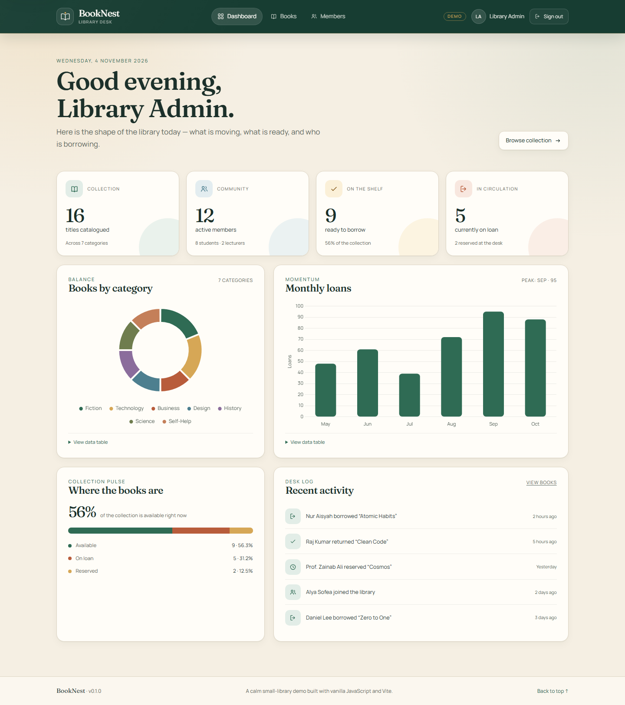
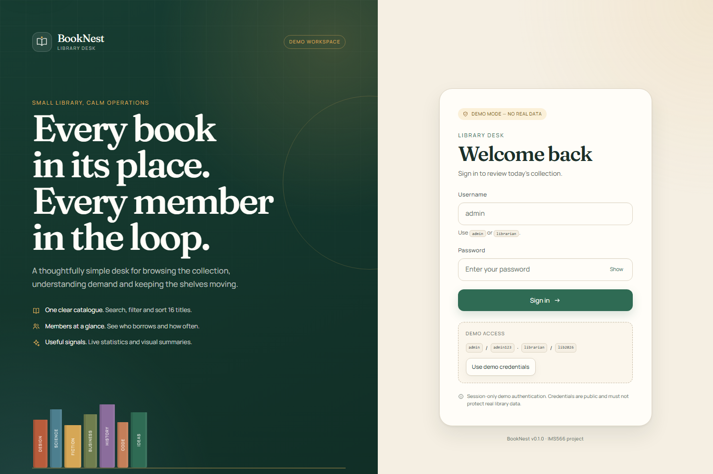
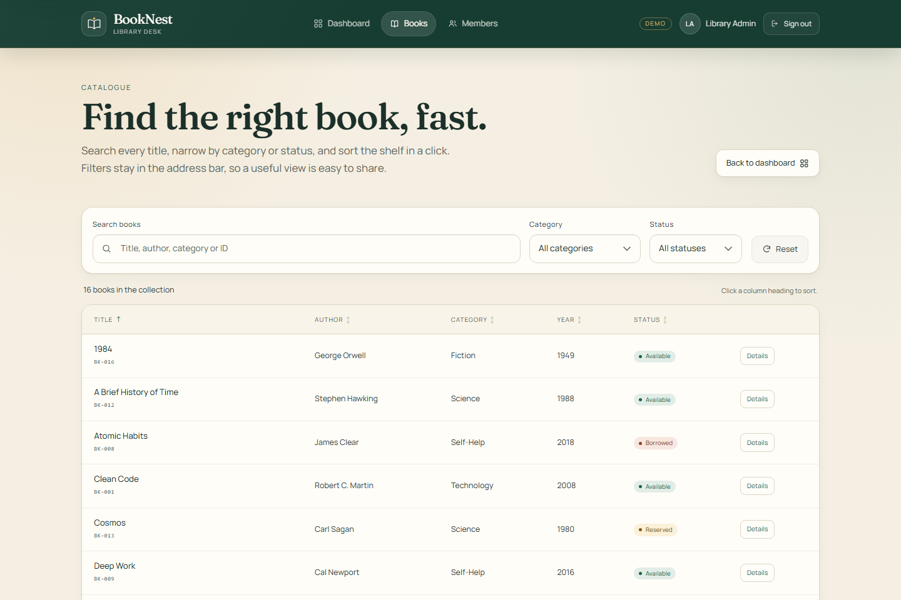
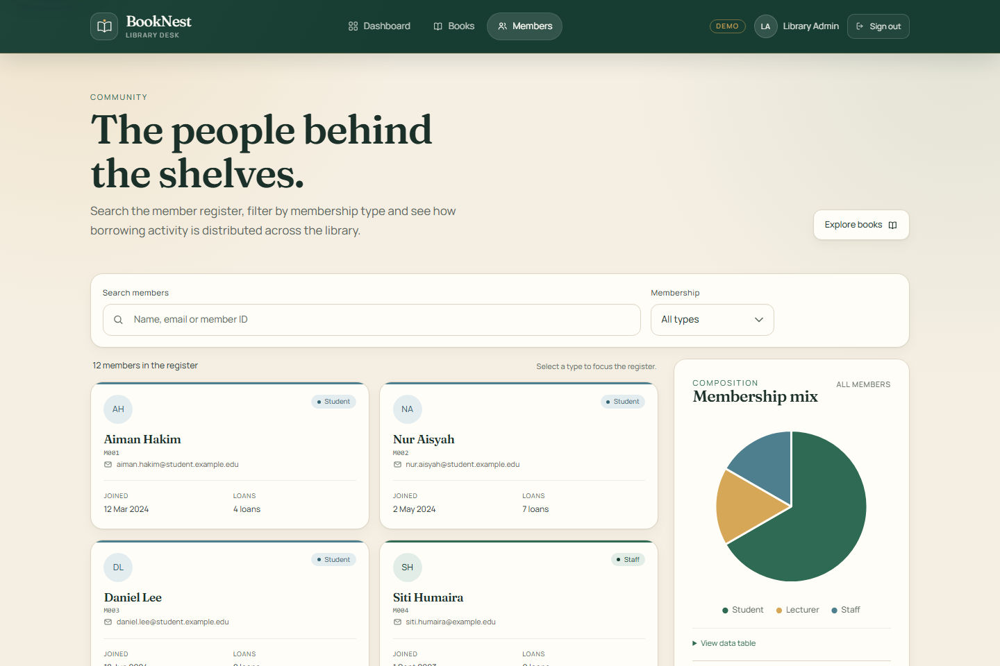
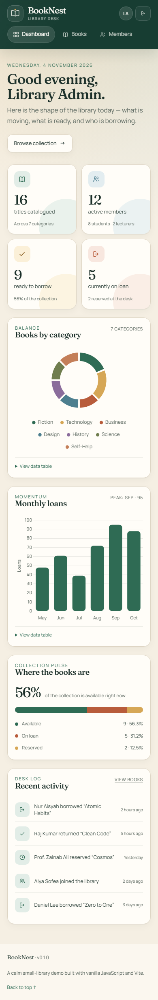
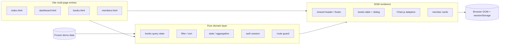

<div align="center">

# BookNest

**A calm, accessible small-library desk for staff who need answers, not another dashboard.**


[Quickstart](#quickstart) · [Features](#features) · [Architecture](#architecture) · [Quality](#quality-gates) · [Docs](docs/) · [Roadmap](#roadmap)

</div>



<details>
<summary>More screens: sign in, catalogue, members, mobile</summary>

| Sign in                                       | Catalogue                                |
| --------------------------------------------- | ---------------------------------------- |
|  |  |

| Members                                  | Mobile dashboard                                           |
| ---------------------------------------- | ---------------------------------------------------------- |
|  |  |

</details>

BookNest is a four-page library management demo: protected staff login, a live dashboard,
a searchable and sortable catalogue, and a member register. It is built as a Vite multi-page
app with vanilla JavaScript, accessible custom CSS, and locally bundled fonts and charts.

> **Demo boundary:** authentication runs entirely in the browser with public demo credentials.
> It demonstrates UX and route protection; it is not a security boundary. See [SECURITY.md](SECURITY.md).

## Quickstart

```bash
npm start
```

That is the whole setup. On a clean machine, `npm start` checks your Node version, installs
dependencies, and opens the app at <http://localhost:5173>. If you prefer explicit steps:

```bash
npm install
npm run dev
```

Sign in with:

| Username    | Password   | Role          |
| ----------- | ---------- | ------------- |
| `admin`     | `admin123` | Administrator |
| `librarian` | `lib2026`  | Librarian     |

Node **20.19+** or **22.12+** is required. No account, database, API key, or internet connection
is needed after installation.

### 60-second tour

1. Sign in with the demo button.
2. Read the dashboard cards, charts, collection pulse, and activity log.
3. Open **Books**, search for `clean`, switch category or status, and click **Details**.
4. Sort by year, then copy the URL — filters and sorting are deep-linkable.
5. Open **Members**, search `zainab`, and filter to **Staff**.
6. Sign out and try opening `/dashboard.html` directly.

## Features

- **Protected staff shell** — session-only demo login, validated session shape and expiry,
  fail-closed pages, and a bfcache re-check after sign-out.
- **Dashboard** — live collection and member statistics, category doughnut, monthly loan bars,
  collection pulse, and recent activity.
- **Catalogue** — 16 titles, accent-insensitive search, category/status filters, sortable columns,
  visible result counts, useful empty states, and an accessible details dialog.
- **Deep links** — book filters and sort order live in the query string and survive refresh.
- **Members** — 12 members, live search, membership filter, loan totals, and a membership pie chart.
- **Accessible charts** — every canvas has a text summary and a `<details>` data-table fallback.
- **Responsive by design** — desktop table becomes readable record cards on small screens; no
  horizontal page overflow at 390 px.
- **Distinctive visual system** — warm paper, deep green, Fraunces display type and Manrope body
  type, all self-hosted; no CDN dependency.
- **Safe DOM rendering** — all data is written with `textContent`/`createElement`, never interpolated
  into HTML.
- **Quality gates** — ESLint, Prettier, unit coverage thresholds, Playwright E2E, axe scans, and a
  build verifier that checks every page and local asset.

## Architecture



**Why this shape?**

- **Pure logic is testable.** Filtering, sorting, stats, query parsing, session validation and
  chart configuration have no DOM dependency.
- **Static pages are cheap and resilient.** No SPA router, no runtime framework, no hydration.
- **The shell is fail-closed.** Protected pages ship with `<div id="app" hidden>`; the page module
  must verify a valid session and finish rendering before revealing it.
- **Assets are local.** Fonts, charts and icons are bundled, so the first-run experience does not
  depend on a third-party CDN.
- **Decisions are recorded.** See the [architecture decision records](docs/adr/).

```text
booknest-library/
├── index.html                 Login page
├── dashboard.html             Statistics, charts, activity
├── books.html                 Catalogue and details dialog
├── members.html               Member register
├── 404.html                   Static fallback page
├── src/
│   ├── components/            Shared DOM/chart adapters
│   ├── data/                  Frozen sample data and constants
│   ├── lib/                   Pure domain + auth + guard logic
│   ├── pages/                 Page composition roots
│   ├── partials/              Build-time header/footer includes
│   └── styles/                Tokens, base, layout, components, login, print
├── tests/
│   ├── unit/                  Vitest tests for pure logic
│   └── e2e/                   Playwright + axe integration tests
├── docs/                      ADRs, screenshots, deployment, release notes
├── scripts/                   Setup, start, build check, screenshots
├── public/                    Favicon, SVG sprite, .nojekyll
└── .github/                   CI, Pages deploy, Dependabot, templates
```

## Quality gates

Run everything locally:

```bash
npm run check        # lint + format check + coverage + production build
npm run test:e2e     # build + Playwright + axe accessibility scans
```

Current results:

| Gate             | Result                                                       |
| ---------------- | ------------------------------------------------------------ |
| Unit tests       | **71 passed**                                                |
| E2E / browser    | **25 passed**                                                |
| Line coverage    | **97.25%** on the pure domain/auth layer                     |
| Accessibility    | **0 serious/critical** axe violations on all pages + dialog  |
| Lint/format      | ESLint and Prettier clean                                    |
| Production build | 5 pages, local assets, verified by `scripts/check-build.mjs` |
| Runtime deps     | 0 high/critical advisories; 5 moderate dev-only ESLint chain |

The only open audit note is a moderate `minimatch` advisory in ESLint's development dependency
chain. It does not ship to users; see `npm audit`. Runtime dependencies are limited to Chart.js and
two font packages.

### Test strategy

- **Unit** — accents, filtering, sorting, query round-trips, stats, percentages, session expiry,
  malformed storage, redirects, bfcache, and chart configs.
- **E2E** — protected routes, bad credentials, demo login, deep links, sort state, dialog focus,
  mobile overflow, search/filter/reset, and logout.
- **Accessibility** — axe scans for login, dashboard, books, open book dialog, and members; manual
  keyboard review of sort buttons, dialog close and focus return.
- **No-JS** — protected pages remain hidden and show a clear noscript message.

## Accessibility

BookNest targets WCAG 2.1 AA for the implemented surfaces:

- Semantic landmarks, one `h1` per page, skip links and visible focus rings.
- Real `<button>`s inside sortable headers with `aria-sort`, not click-only table cells.
- Labels for every search/filter control; result counts announced with `role="status"`.
- Charts expose `role="img"`, a generated summary, and an expandable data table.
- Native `<dialog>` with labelled title, Escape support, backdrop close and focus return.
- `prefers-reduced-motion` respected in CSS and chart animation.
- Decorative SVG icons are `aria-hidden`; text labels remain visible.
- Responsive table-to-card layout without page-level horizontal scrolling.

## Security model

This is a **client-side demo**, not a production authentication system:

- Credentials are public and stored in the client bundle.
- `sessionStorage` is editable by the visitor; the guard is a UX gate, not an access control.
- An XSS would be a full session bypass by design. The app avoids HTML interpolation and runs under
  a restrictive meta CSP (`script-src 'self'`, `object-src 'none'`, `base-uri 'none'`).
- No passwords or secrets are stored in the session; sessions expire after 8 hours.
- GitHub Pages cannot set security headers. A production deployment should add real server-side
  auth, HTTPS headers, CSRF protection and rate limiting.

See [SECURITY.md](SECURITY.md) and [ADR-0002](docs/adr/0002-demo-authentication.md).

## Deployment

The repository includes a GitHub Pages workflow that deploys `dist/` after a successful CI run.

1. Publish the repository (see [docs/github-publishing.md](docs/github-publishing.md)).
2. In **Settings → Pages**, choose **GitHub Actions** as the source.
3. Push to `main`; the Pages workflow runs after CI.

Vite uses a relative base, so the same build works at a project URL such as
`https://<owner>.github.io/booknest-library/`.

## Assignment mapping

This project fulfils and extends the original IMS566 brief:

| Requirement                           | Implementation                                               |
| ------------------------------------- | ------------------------------------------------------------ |
| Simulated login + validation          | Accessible form, demo fill, error states, show/hide password |
| Session protection + logout           | Versioned session, expiry, guarded pages, bfcache re-check   |
| Consistent responsive navigation      | Build-time shared header, active page state, mobile nav      |
| Dashboard cards and charts            | Live stats, doughnut, bar chart, pulse, activity             |
| Dataset 1: books with search/filter   | 16 books, category/status filters, search and sort           |
| Dataset 2: members with search/filter | 12 members, live search, type filter                         |
| Data visualisation                    | Chart.js with accessible data-table fallbacks                |
| Semantic, commented, separated code   | ES modules, CSS layers, partials, JSDoc where useful         |
| Responsive design                     | Mobile, tablet and desktop layouts verified in Playwright    |

## Roadmap

- [ ] Add a server-backed API and real authentication (OIDC or library SSO).
- [ ] Add create/edit book and member flows with audit logging.
- [ ] Add loan and reservation workflows with due-date reminders.
- [ ] Add CSV import/export for catalogue migration.
- [ ] Add visual regression snapshots to CI.
- [ ] Add dark mode with a persisted, accessible theme preference.

## Contributing

Read [CONTRIBUTING.md](CONTRIBUTING.md) before opening a pull request. Use conventional commits,
keep changes focused, and run `npm run check` plus `npm run test:e2e`.

## License

[MIT](LICENSE) © 2026 BookNest contributors.
